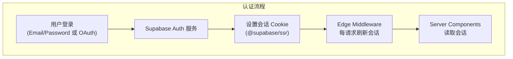
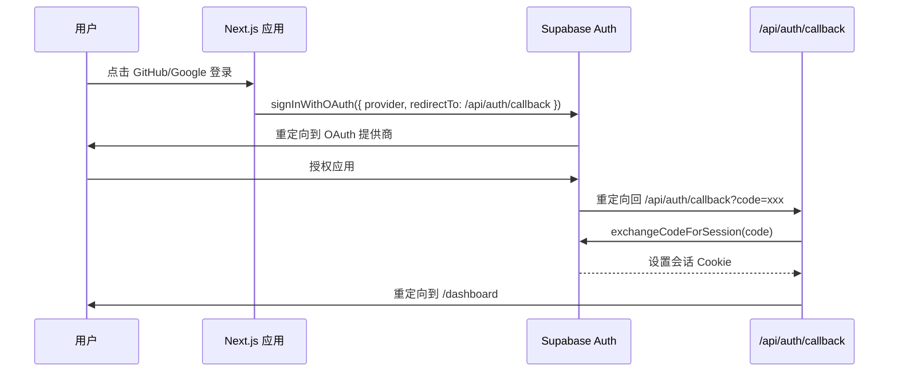
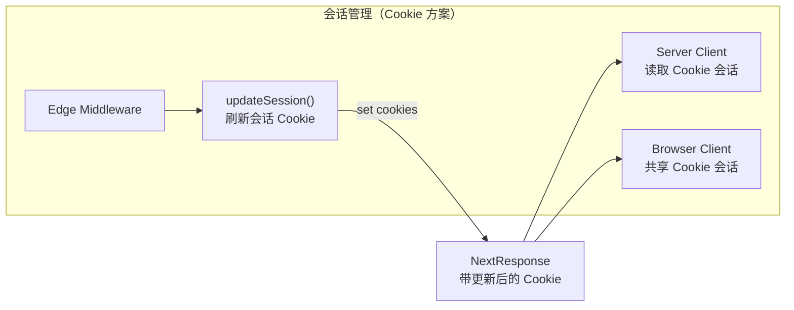
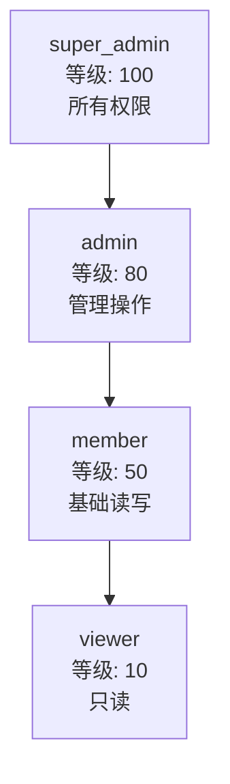
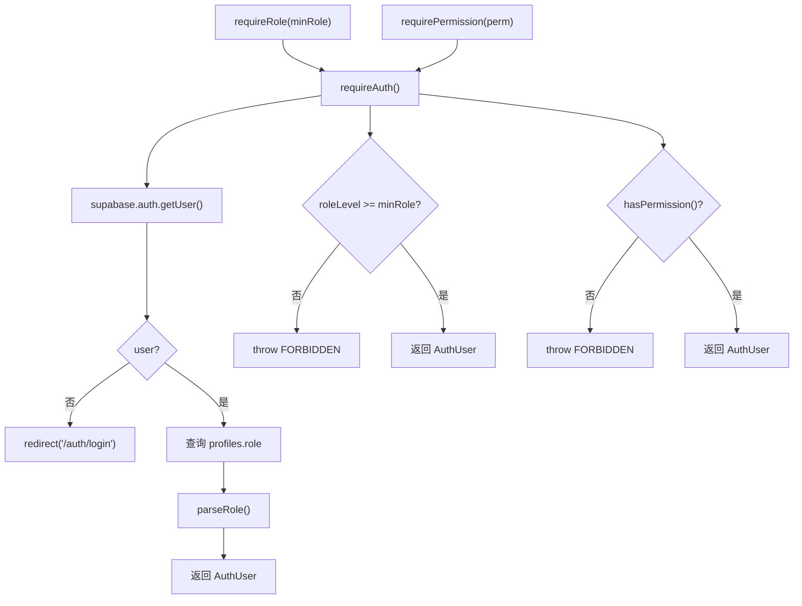

# 认证与 RBAC 权限系统

## 认证架构



### 认证方式

| 方式 | 状态 | 配置 |
|------|------|------|
| Email/Password | 已启用 | Supabase Auth 内置 |
| GitHub OAuth | 已启用 | `auth.external.github` |
| Google OAuth | 已启用 | `auth.external.google` |
| WeChat | 可选 | 配置中预留 |
| Apple | 可选 | 配置中预留 |

### OAuth 回调流程



### 会话管理



三种 Supabase 客户端的会话处理：

| 客户端 | 会话来源 | 用途 |
|--------|----------|------|
| Middleware Client | `request.cookies` | Edge 中间件会话刷新 |
| Server Client | `cookies()` | Server Components / Actions |
| Browser Client | 浏览器 Cookie | Client Components |

### 第二步验证（2FA / TOTP）

2FA 是**服务端闸门**，不是登录表单的一次跳转。

| 环节 | 位置 | 做什么 |
|------|------|--------|
| 登录后跳转 | `src/components/auth/login-form.tsx` | 读到已验证因子就 `router.push("/auth/mfa?factor=…")`——这只是**引导**，不是控制 |
| 服务端判定 | `src/lib/auth/mfa-assurance.ts` | 读 `mfa.getAuthenticatorAssuranceLevel()`：`nextLevel === "aal2"` 且 `currentLevel !== "aal2"` ⇒ 重定向到挑战页（带上因子 id 与回跳地址） |
| 闸门接线 | `src/app/dashboard/layout.tsx` | 在 layout 里调用，覆盖**所有** `/dashboard/**`；逐页调用会漏页，而漏一页就是一个入口 |
| 挑战页可达性 | `src/proxy.ts` | `/auth/mfa` **不在** `authRoutes` 里——那是已登录（aal1）用户去完成第二步的地方，而 `authRoutes` 的分支恰恰是「已登录 ⇒ 弹回仪表盘」 |

两条边界值得记住：

- **没开 2FA 的账号一条都不受影响**：判据要求 `nextLevel === "aal2"`，没因子时它仍是 `aal1`。
  写成「所有人必须 aal2」等于改掉整个模板的登录语义。
- **读数失败时拦（503），而不是放行**：读不到就放行是这套控制最贵的失效方式——
  Auth 一抖 2FA 静默失效且没有任何读数。修法与「会话读不出来」一致：抛
  `SERVICE_UNAVAILABLE`，由仪表盘 `error.tsx` 给可重试页面（不登出，重试一次即恢复）。

> 为什么这条曾经形同不存在：`grep -rn "getAuthenticatorAssuranceLevel" src/` 在 2026-10-31
> 之前是 **0 命中**。Supabase 对已开 MFA 的账号在密码登录后签发的是 **aal1** 会话，
> 而 RLS 的 `auth.uid()` 在 aal1 下照常生效——所以「前端会跳转」是当时唯一的控制。

### 登录失败锁定：它防的是什么，以及它的爆炸半径

`src/lib/actions/login-attempts.ts` 是**匿名**可用的一组 action（登录页本来没有会话），
双维度滑窗：归一化邮箱 5 次 / 15 分钟，出口 IP 20 次 / 15 分钟，任一维度超限即拒绝尝试。
硬限频仍由 Supabase Auth 负责，这一层是 UX 与审计。

两条必须挂在心上的事实：

- **「这个文件里的每个 export 都是一条可 POST 的路径」。** 清空计数桶原先也在这里
  （`clearLoginBuckets`），即「谁调到它，全站双维度锁定归零」，没有鉴权、没有身份判定。
  当时唯一的缓冲是「没有客户端 import 它」——那不是授权，是一次等着被打破的默契
  （任何一次「顺手加个清空按钮」都会把它变成公开入口）。现在桶与清空入口搬进
  `src/lib/auth/login-buckets.ts`（普通模块，没有网络表面），并有单测钉住导出面只有
  `checkLoginAllowed` / `recordLoginResult` 两个名字。
- **失败上报对「任意邮箱」的成本被出口 IP 的额度卡住。** 入参就是「邮箱 + 布尔值」，
  所以任何人都能替任意邮箱宣布一次登录失败；五个 POST 锁死一个账号 15 分钟。
  这**不是**「绕过限频」（绕过 `checkLoginAllowed` 直接打 Supabase `/token` 本来也行），
  而是「第三方可对指定账号制造登录拒绝」。现在当出口 IP 自己的失败额度用尽后，
  不再受理新的失败上报 ⇒ 同一 IP 每窗口最多锁 4 个邮箱，而不是无上限。
  **残留风险**：分布式出口仍可锁账号。真正的修法是把认证挪到服务端，由服务端自己产生
  「失败」这个事实，而不是让客户端上报——那是一次认证链路重构，尚未做。

## RBAC 权限系统

### 角色层级



### 权限矩阵

```mermaid
graph LR
    subgraph Domains["权限域"]
        User["user:read/write/delete/manage"]
        Team["team:read/write/delete/invite/remove"]
        Project["project:read/write/delete/manage"]
        Billing["billing:read/write/manage"]
        Settings["settings:read/write"]
        Analytics["analytics:read/export"]
        Integration["integration:read/write"]
        Notification["notification:read/write"]
        System["system:read/write/manage"]
        Audit["audit:read/export"]
    end
```



| 权限 | viewer | member | admin | super_admin |
|------|:------:|:------:|:-----:|:-----------:|
| user:read | yes | yes | yes | yes |
| user:write | - | yes | yes | yes |
| user:manage | - | - | yes | yes |
| user:delete | - | - | - | yes |
| team:read | yes | yes | yes | yes |
| team:write | - | - | yes | yes |
| team:invite | - | - | yes | yes |
| team:remove | - | - | yes | yes |
| team:delete | - | - | - | yes |
| project:read | yes | yes | yes | yes |
| project:write | - | yes | yes | yes |
| project:manage | - | - | yes | yes |
| project:delete | - | - | yes | yes |
| billing:read | - | yes | yes | yes |
| billing:write | - | - | yes | yes |
| billing:manage | - | - | yes | yes |
| settings:read | yes | yes | yes | yes |
| settings:write | - | yes | yes | yes |
| analytics:read | yes | yes | yes | yes |
| analytics:export | - | - | yes | yes |
| integration:read | - | yes | yes | yes |
| integration:write | - | - | yes | yes |
| notification:read | yes | yes | yes | yes |
| notification:write | - | yes | yes | yes |
| system:read | - | - | - | yes |
| system:write | - | - | - | yes |
| system:manage | - | - | - | yes |
| audit:read | - | - | - | yes |
| audit:export | - | - | - | yes |

### 权限命名规范

```
<domain>:<action>
```

支持的 action：`read` / `write` / `create` / `delete` / `manage` / `invite` / `remove` / `export`

### 团队角色

| 团队角色 | 映射到系统角色 | 说明 |
|----------|---------------|------|
| owner | admin | 团队创建者 |
| admin | admin | 团队管理员 |
| member | member | 普通成员 |

## 守卫函数

### Server Component 守卫（抛异常 / 重定向）



| 函数 | 用途 | 失败行为 |
|------|------|----------|
| `requireAuth()` | 获取当前用户 | 重定向到登录页 |
| `requireRole(minRole)` | 要求最低角色 | 抛出 FORBIDDEN |
| `requirePermission(perm)` | 要求具体权限 | 抛出 FORBIDDEN |

### API Route 守卫（返回 Result 类型）

| 函数 | 用途 | 失败行为 |
|------|------|----------|
| `safelyRequireAuth()` | 获取当前用户 | 返回 `{ success: false, error }` |
| `safelyRequireRole(minRole)` | 要求最低角色 | 返回 `{ success: false, error }` |
| `safelyRequirePermission(perm)` | 要求具体权限 | 返回 `{ success: false, error }` |

### 错误类型

```typescript
class AuthGuardError extends Error {
  code: "UNAUTHORIZED" | "FORBIDDEN" | "NOT_FOUND"
}
```

| 错误码 | 含义 | HTTP 状态码 |
|--------|------|-------------|
| UNAUTHORIZED | 未登录 | 401 |
| FORBIDDEN | 权限不足 | 403 |
| NOT_FOUND | 资源不存在 | 404 |

## 权限使用示例

```typescript
// Server Component
import { requireRole, requirePermission } from "@/lib/auth/guards"

// 要求 admin 角色
const user = await requireRole("admin")

// 要求 team:invite 权限
const user = await requirePermission(PERMISSIONS.team.invite)
```

```typescript
// API Route
import { safelyRequireAuth } from "@/lib/auth/guards"

const result = await safelyRequireAuth()
if (!result.success) {
  return NextResponse.json({ error: result.error.message }, { status: 401 })
}
const user = result.data
```

```typescript
// 组件级权限控制
import { PermissionGate } from "@/components/shared/permission-gate"

<PermissionGate permission={PERMISSIONS.team.invite}>
  <InviteButton />
</PermissionGate>
```
